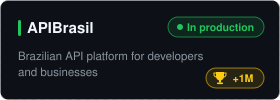
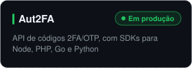
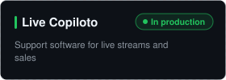
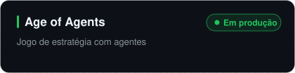
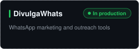

<!-- Header -->
<p align="center">
  
</p>

<p align="center">
  <a href="https://codetime.dev"></a>
  
  <a href="https://www.linkedin.com/in/jhowbhz/"></a>
  <a href="https://x.com/jhowbhz"></a>
  <a href="https://pt.stackoverflow.com/users/128217/jhowbhz"></a>
  <a href="https://apibrasil.io"></a>
  <a href="https://gist.github.com/jhowbhz"></a>
</p>

<p align="center">
  
</p>

---

### 👨‍💻 Sobre mim

```yaml
nome:        Jonathan (Jhon)
local:       Brasil, Minas Gerais 🇧🇷
cargo:       Senior Software Engineer & Founder
experiencia: 9 anos de código, construindo produtos em produção
foco:        APIs, SaaS, integrações e infraestrutura
agora:       escalando a APIBrasil e lançando novos produtos
```

- Fundador da **[APIBrasil](https://github.com/apibrasil)** - plataforma de APIs para desenvolvedores e empresas brasileiras
- Da arquitetura ao deploy: backend, frontend, DevOps e observabilidade
- Compartilho conteúdo técnico no YouTube e no blog da APIBrasil
- Fale comigo sobre **APIs, automação, SaaS e infraestrutura**

---

### 🧰 Stack

<p>
  
</p>

---

### 🚀 Projetos

<p>
  <a href="https://github.com/apibrasil"></a>
  <a href="https://aut2fa.com"></a>
  <a href="https://livecopiloto.com"></a>
  <a href="https://ageofagents.io"></a>
  <a href="https://github.com/divulgawhats"></a>
  <a href="https://github.com/jhowbhz?tab=repositories"></a>
</p>

---

### 📊 GitHub em números

<p align="center">
  
  
  
</p>
