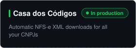

<p align="center">
  <a href="https://github.com/jhowbhz/jhowbhz/blob/master/README.pt-BR.md"></a>
  
</p>

<p align="center">
  <a href="https://codetime.dev"></a>
  
  <a href="https://www.linkedin.com/in/jhowbhz/"></a>
  <a href="https://x.com/jhowbhz"></a>
  <a href="https://pt.stackoverflow.com/users/128217/jhowbhz"></a>
  <a href="https://apibrasil.io"></a>
  <a href="https://gist.github.com/jhowbhz"></a>
</p>

<p align="center">
  <a></a>
</p>

---

### About me

```yaml
name:        Jonathan (Jhon)
location:    Brazil, Minas Gerais 🇧🇷
role:        Senior Software Engineer & Founder
time:        9 years of coding, shipping products to production
focus:       APIs, SaaS, integrations and infrastructure
now:         scaling APIBrasil and launching new products
```

- Founder of **[APIBrasil](https://apibrasil.io)** - API platform for Brazilian developers and businesses
- From architecture to deploy: backend, frontend, DevOps and observability
- I share technical content on YouTube and on the APIBrasil blog
- Talk to me about **APIs, automation, SaaS and infrastructure**

---

### Stack

<p>
  <a></a>
</p>

---

### Projects

<p>
  <a href="https://apibrasil.io"></a>
  <a href="https://divulgawhats.com"></a>
  <a href="https://livecopiloto.com"></a>
  <a href="https://ageofagents.io"></a>
  <a href="https://casadoscodigos.com.br"></a>
  <a></a>
</p>

---

### GitHub stats

<p align="center">
  <a></a>
  <a></a>
  <a></a>
</p>
